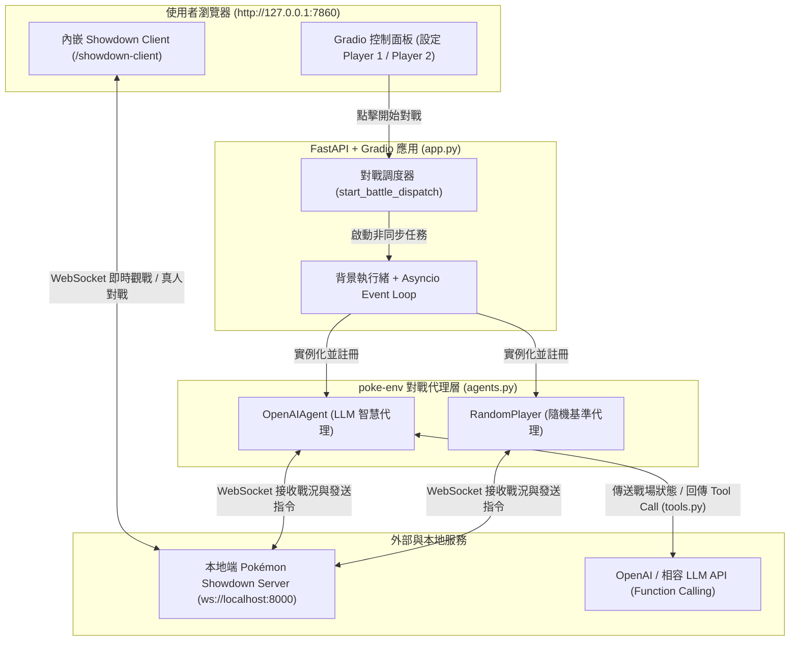
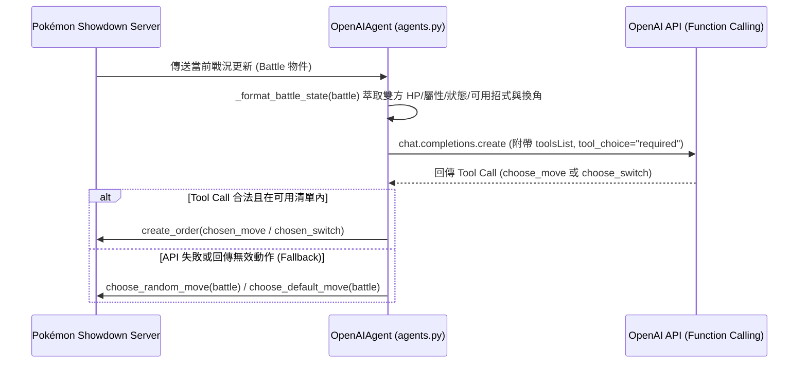

# 🎮 Poke-Agent — Pokémon Showdown AI 對戰平台

基於 [`poke-env`](https://github.com/hsahovic/poke-env)、OpenAI Function Calling 與 Gradio 打造的寶可夢對戰 AI 平台。連接本地端 Pokémon Showdown 伺服器，透過瀏覽器介面即可進行 **AI vs AI 自動對戰觀戰**、**人機對戰 (Human vs AI)** 以及 **雙人自由配對**。

---

## ✨ 功能特色

- **🤖 OpenAI 智慧代理 (`OpenAIAgent`)**
  - 即時解析戰場資訊（雙方寶可夢屬性、HP 比例、異常狀態、能力階級變化、可用招式、可替換寶可夢、天氣、場地與場地狀態）。
  - 透過 OpenAI **Function Calling (`tools`)** 強制決策出招（`choose_move`）或換角（`choose_switch`），並具備自動容錯回退機制（Fallback）。
  - 支援自訂 `OPENAI_BASE_URL` 與 `OPENAI_MODEL`，可輕鬆串接 OpenAI、OpenRouter、Azure OpenAI 或本地端相容 API（如 Ollama、vLLM）。
- **🎲 隨機策略代理 (`RandomPlayer`)**
  - 內建隨機出招/換角的基準 AI，方便測試環境與進行 AI 強度對照。
- **⚔️ 多元對戰模式**
  - **AI vs AI**：一鍵啟動背景雙 AI 對戰，直接於內嵌畫面點擊 `Watch a battle` 即時觀戰。
  - **AI vs 真人**：AI 自動向指定 Showdown 玩家暱稱發送對戰邀請（預設賽制為 `gen9randombattle`）。
  - **真人 vs 真人**：支援雙人於本地伺服器自由發起挑戰。
- **🖥️ 內嵌 Pokémon Showdown 網頁客戶端**
  - 使用 FastAPI 掛載 Gradio 介面與客製化 `showdown_client.html`（移除 Framebust 限制並預設指向 `localhost:8000`），無須切換視窗即可在同一頁面操作與觀戰。

---

## 🏗️ 系統架構

### 1. 整體架構圖

系統由 **FastAPI + Gradio 網頁端 (Port `7860`)**、**`poke-env` 對戰代理**、**本地端 Pokémon Showdown 伺服器 (Port `8000`)** 與 **OpenAI 相容 LLM API** 四大核心元件組成：



### 2. `OpenAIAgent` 單回合決策流程

每當輪到 `OpenAIAgent` 行動時，`poke-env` 會非同步呼叫 `choose_move(battle)`，依序執行以下步驟：



### 3. 核心模組職責

| 模組檔案 | 角色與職責 |
| :--- | :--- |
| `src/poke_agent/app.py` | 透過 FastAPI 整合 Gradio UI 與 `/showdown-client` 靜態頁面；負責管理背景執行緒與 `asyncio` 事件迴圈，調度 AI vs AI (`battle_against`) 或 AI vs 真人 (`send_challenges`)。 |
| `src/poke_agent/agents.py` | 繼承 `poke_env.player.Player` 實作 `OpenAIAgent`，負責將複雜的 `Battle` 物件轉換為結構化 Prompt、透過 `AsyncOpenAI` 請求模型決策，並將模型回傳名稱對應回 `Move` 或 `Pokemon` 物件。 |
| `src/poke_agent/tools.py` | 定義提供給 OpenAI Function Calling 的 JSON Schema 工具：`choose_move(move_name)` 與 `choose_switch(pokemon_name)`。 |
| `src/poke_agent/config.py` | 自動尋找並載入 `.env` 環境變數（支援 `python-dotenv` 與內建解析器雙重機制），統一提供 `OPENAI_API_KEY`、`OPENAI_MODEL` 與 `OPENAI_BASE_URL`。 |
| `src/poke_agent/build_client.py` | 抓取官方 Showdown 前端頁面，移除 `framebust` 限制並注入本地端伺服器設定 (`localhost:8000`)，產生可嵌入 `<iframe>` 的 `showdown_client.html`。 |

---

## 🛠️ 前置需求

1. **Python 環境**：Python `>= 3.13`（推薦使用 [`uv`](https://docs.astral.sh/uv/) 管理套件與虛擬環境）。
2. **Node.js**：用於執行本地端 Pokémon Showdown 伺服器。
3. **本地端 Pokémon Showdown Server**（預設運行於 `localhost:8000`）：
   ```bash
   git clone https://github.com/smogon/pokemon-showdown.git
   cd pokemon-showdown
   npm install
   cp config/config-example.js config/config.js
   node pokemon-showdown start --no-security
   ```
   > 💡 啟動時請加上 `--no-security` 參數，以便本地端 AI 代理免密碼快速註冊與登入。

---

## 🚀 安裝與設定

### 1. 安裝專案套件

**使用 `uv`（推薦）：**
```bash
uv sync
```

**或使用 `pip`：**
```bash
pip install -r requirements.txt
pip install -e .
```

### 2. 設定環境變數 (`.env`)

複製專案根目錄的 `.env.example` 為 `.env`：

```bash
cp .env.example .env
```

編輯 `.env` 填入你的 API 設定：

```dotenv
# OpenAI API 金鑰（使用 OpenAI Agent 時必填）
OPENAI_API_KEY=your_openai_api_key_here

# 使用的模型名稱
OPENAI_MODEL=gpt-6-luna

# 選填：自訂 OpenAI 相容 API 端點（例如 OpenRouter、Proxy、Ollama 等）
OPENAI_BASE_URL=
```

---

## 🎮 啟動與使用方式

確認本地端 Pokémon Showdown 伺服器（Port `8000`）已啟動後，執行以下指令啟動 Gradio 網頁應用：

```bash
uv run poke-agent
```
或直接以 Python 模組執行：
```bash
python -m poke_agent.app
```

啟動後請在瀏覽器開啟：**http://127.0.0.1:7860**

### 對戰操作指南

1. **AI vs AI 觀戰**
   - 將 **Player 1 (紅方)** 與 **Player 2 (藍方)** 分別選為 `🤖 OpenAI Agent` 或 `🎲 Random Player`。
   - 點擊 **「⚔️ 開始對戰 / 發起挑戰」**。
   - 在下方內嵌的 Showdown 畫面點擊 **「Watch a battle」**，即可選擇正在進行的對戰房間即時觀戰。
2. **人機對戰 (Human vs AI)**
   - 先在下方的 Showdown 畫面右上角點擊 **「Choose name」** 登入一個自訂暱稱。
   - 在上方選擇一方為 `👤 Human Player (真人玩家)` 並輸入剛才登入的 Showdown 暱稱，另一方選擇 AI。
   - 點擊 **「⚔️ 開始對戰 / 發起挑戰」**，下方 Showdown 畫面即會收到來自 Bot 的挑戰邀請，點擊 **「Accept」** 開始對戰！

---

## 📁 專案結構

```text
poke-agent/
├── .env.example                  # 環境變數範本
├── pyproject.toml                # 專案設定與依賴套件定義
├── requirements.txt              # pip 相容依賴列表
└── src/
    └── poke_agent/
        ├── __init__.py
        ├── app.py                # FastAPI + Gradio 介面與背景對戰調度邏輯
        ├── agents.py             # OpenAIAgent 類別（戰況格式化、API 呼叫與動作解析）
        ├── tools.py              # OpenAI Function Calling 工具定義 (choose_move / choose_switch)
        ├── config.py             # .env 環境變數載入與設定管理
        ├── build_client.py       # 下載並修補 Showdown 前端 HTML 的輔助腳本
        └── showdown_client.html  # 內嵌用本地端 Pokémon Showdown 客戶端頁面
```

---

## 📚 參考資料

- [Hugging Face Agents Course - Bonus Unit 3: Agents in Games (Pokemon)](https://huggingface.co/learn/agents-course/bonus-unit3/introduction)
- [Hugging Face Agents Course - Bonus Unit 3（繁體中文版）](https://huggingface.tw/learn/agents-course/bonus-unit3/introduction)

